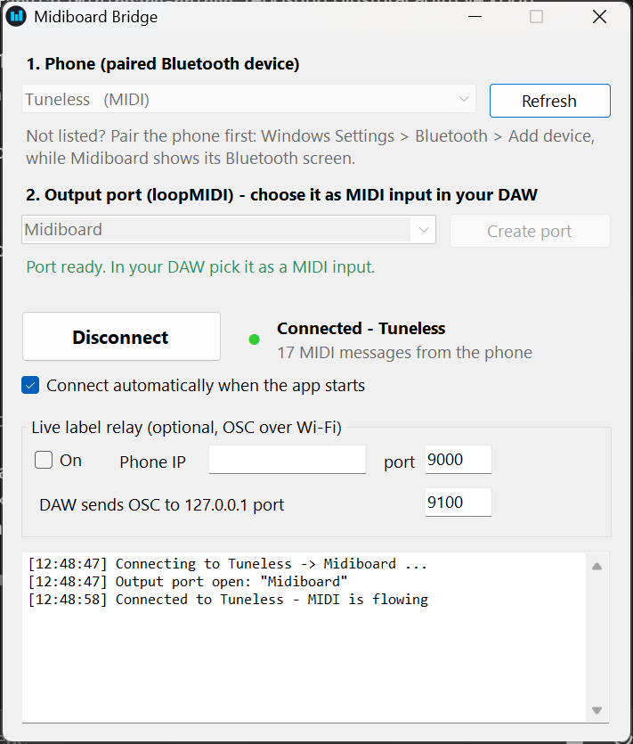

# Midiboard Bridge

Play your Windows music software from **[Midiboard](https://midiboard.bulatapps.com)** on your iPhone, over Bluetooth.

Most Windows music software only sees classic MIDI ports and cannot use a Bluetooth MIDI device directly.
Midiboard Bridge connects to your phone over Bluetooth LE and passes everything you play into a virtual MIDI port
that your DAW or live host can open like any other MIDI input.



- **Finds and connects by itself.** Pick your phone once; the Bridge keeps trying until the link is really up
  (it confirms the MIDI data channel, not just the Bluetooth connection) and reconnects on its own if it drops.
- **One click to create the port.** Uses the free loopMIDI driver for the virtual port and can create the port for you.
- **Optional live label relay.** If your live host sends song names over OSC, the Bridge forwards them to Midiboard
  over Wi-Fi and repeats the latest ones every second, so a lost packet never leaves a stale label on stage.
- Single `.exe`, no installer. English and Turkish.

## Requirements

- Windows 10 (version 1803 or later) or Windows 11, 64-bit, with Bluetooth LE
- [loopMIDI](https://www.tobias-erichsen.de/software/loopmidi.html) — free virtual MIDI port driver (install it once)
- Midiboard on your iPhone or iPad

## Setup

1. Install **loopMIDI**.
2. In Midiboard open the **Bluetooth** connection screen. On Windows go to
   **Settings › Bluetooth & devices › Add device › Bluetooth** and pair your phone.
3. Download `MidiboardBridge.exe` from [Releases](../../releases) and run it.
4. **Phone:** choose your phone (devices with Bluetooth MIDI are marked *(MIDI)*).
   **Output port:** keep `Midiboard` and press **Create port**.
5. Press **Connect**. When the dot turns green, choose **Midiboard** as a MIDI input in your music software.

Tick *Connect automatically when the app starts* and next time it is a single double-click. Closing the window keeps
the Bridge running in the system tray; use the tray icon's **Exit** to quit.

## Live label relay (optional)

For hosts that send the current song / preset name over OSC:

1. Connect the phone and the PC to the same Wi-Fi network (or the PC's mobile hotspot). Give the phone a fixed IP.
2. In the Bridge turn the relay **On**, enter the phone's IP, keep port `9000` (Midiboard listens there).
3. In your host's OSC settings send to **127.0.0.1**, port **9100**.

## Troubleshooting

| Problem | Try |
|---|---|
| Phone not in the list | Pair it first (Setup step 2) with Midiboard's Bluetooth screen open, then **Refresh**. |
| Stays on *Connecting…* | Keep Midiboard on its Bluetooth screen. Windows sometimes needs a few tries; the Bridge keeps trying. If it says *no Bluetooth MIDI service*, check you picked the right device. |
| *Port does not exist* | Install loopMIDI, then **Create port**. |
| Windows SmartScreen warning | The app is not code-signed yet. Click **More info › Run anyway**. |
| Nothing arrives in the DAW | Make sure the DAW's MIDI input is the same port name shown in the Bridge. |

## Build from source

No SDK needed — the C# compiler that ships with Windows is enough:

```
src\build.bat
```

The executable is written to `src\bin\MidiboardBridge.exe`. `src\make-icon.ps1` regenerates the icon.

## License

[MIT](LICENSE). loopMIDI is a separate product by Tobias Erichsen and is not part of this project.

---

## Türkçe

**Midiboard Bridge**, iPhone'daki Midiboard'u Bluetooth üzerinden Windows'taki müzik yazılımına bağlar. Windows müzik
yazılımlarının çoğu Bluetooth MIDI cihazlarını doğrudan göremez; Bridge telefona bağlanır ve çaldığın her şeyi DAW'ın
MIDI girişi olarak seçebileceği sanal bir porta aktarır.

1. **loopMIDI**'yi kur (ücretsiz).
2. Midiboard'da **Bluetooth** bağlantı ekranını aç; Windows'ta **Ayarlar › Bluetooth ve cihazlar › Cihaz ekle**
   ile telefonu eşleştir.
3. [Releases](../../releases)'tan `MidiboardBridge.exe`'yi indir ve çalıştır.
4. Telefonunu seç, port adı `Midiboard` kalsın, **Port oluştur**'a bas.
5. **Bağlan**'a bas; nokta yeşil olunca DAW'da MIDI girişi olarak **Midiboard**'u seç.

Windows "tanınmayan uygulama" derse: **Ek bilgi › Yine de çalıştır** (uygulama henüz kod imzalı değil).
